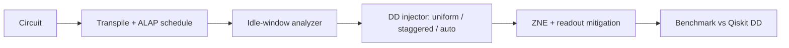

<div align="center">

# QubitCrew

**VTU-QFF-HC-0184** &nbsp;|&nbsp; Tier: **Online**

</div>

---

<div align="center">

| | |
| :--- | :--- |
| **Team** | QubitCrew |
| **Team ID** | VTU-QFF-HC-0184 |
| **Tier** | Online |
| **Repository** | [vtu-hc-qubitcrew](https://github.com/vtu-qiskit-fall-fest-2026/vtu-hc-qubitcrew.git) |
| **Organisation** | [vtu-qiskit-fall-fest-2026](https://github.com/vtu-qiskit-fall-fest-2026) |
| **Event** | VTU-QFF Hackathon — VTU-Qiskit Fall Fest 2026 |
| **Live demo** | [qubitcrew-dd.streamlit.app](https://qubitcrew-dd.streamlit.app/) |
| **Demo video** | See [YouTube_Demo_Link.md](YouTube_Demo_Link.md) |
| **Presentation** | [docs/QubitCrew_VTU-QFF-HC-0184.pptx](docs/QubitCrew_VTU-QFF-HC-0184.pptx) |

</div>

---

## 📌 Table of Contents

- [Team Members](#-team-members-github-ids)
- [Problem Statement](#-problem-statement)
- [Proposed Solution](#-proposed-solution)
- [Approach & Architecture](#-approach--architecture)
- [Tech Stack](#-tech-stack)
- [Project Structure](#-project-structure)
- [How to Run](#-how-to-run)
- [How to Push Code](#-how-to-push-code)
- [Submission Checklist](#-submission-checklist)
- [Resources](#-resources)
- [License](#-license)

---

## 👥 Team Members (GitHub IDs)

> Members are added to this repository as **collaborators** and must accept the
> GitHub invitation before they can push. Add your GitHub username below.

| # | Name | GitHub Username | Role |
| :-- | :--- | :--- | :--- |
| 1 | Prisha Bharti | [@prishabharti](https://github.com/prishabharti) | Team Lead |
| 2 | Aarti Singla | [@aarti-singla](https://github.com/aarti-singla) | Developer |
| 3 | Angel Garg | [@angelgarg](https://github.com/angelgarg) | Developer |

---

## ❓ Problem Statement

**Problem:** On NISQ devices, qubits that sit idle while their neighbours run gates dephase and pick up ZZ crosstalk, and gate errors keep accumulating. Dynamical decoupling (DD) and error mitigation (ZNE, readout mitigation) each help, but they are usually applied separately, without knowing what the neighbouring qubits are doing, and without checking that they work together.

**Why it matters:** Idle time is a large fraction of real circuits. A DD pass that ignores context either wastes pulses (imperfect pulses cost fidelity) or leaves crosstalk untouched, and stacking mitigation on top without a plan can add variance without adding accuracy.

**Track / Category:** Online · Integrated Dynamical Decoupling and Error Mitigation Pipeline for NISQ Workflows

---

## 💡 Proposed Solution

**Solution:** An automated Qiskit pipeline that compiles and ALAP-schedules a circuit with real device durations, finds every idle window, classifies it (*idle-idle* vs *crosstalk-idle*), injects crosstalk-aware DD, selects the DD strategy and pulse spacing automatically, then layers ZNE and readout mitigation on top. Everything is benchmarked against Qiskit's own `PadDynamicalDecoupling`, on a physical noise model and on real IBM Heron hardware. A Streamlit dashboard shows the schedule before/after DD, a live benchmark and all results.

**Key idea:** Identical DD trains on coupled neighbours leave ZZ crosstalk intact (the two sign flips cancel in the product), while **staggered** trains refocus it. The injector picks pulse placement per window by minimising a ZZ-frame cost, and "no DD" is always a candidate, so auto-DD cannot hurt on the device model.

**Why this works:** It is schedule-aware: pulses go only where a window is long enough to pay for them and where a neighbour's timing makes staggering useful.

**Results.** *Simulation* (noisy device model, 6 workloads): auto-DD cuts mean infidelity from 0.281 (no DD) to 0.129, a 54 % reduction (Qiskit's DD: 0.142), with the largest gains on circuits with long synchronous idle periods (GHZ-wait 0.674 → 0.871). *Real IBM Heron r2 hardware*, spectator test (four idle qubits next to a busy CZ pair; mean ⟨X⟩ of the idle qubits, ideal = 1; interleaved repeats): staggered DD was the best configuration on all three devices.

| Device | No DD | Qiskit PadDD | IBM Runtime DD | Our DD uniform | **Our DD staggered** |
| :--- | ---: | ---: | ---: | ---: | ---: |
| ibm_fez | −0.05 | 0.67 | 0.63 | 0.67 | **0.78** |
| ibm_kingston | 0.28 | 0.79 | 0.80 | 0.79 | **0.82** |
| ibm_marrakesh | 0.07 | 0.62 | 0.62 | 0.64 | **0.67** |

In a separate crosstalk test on ibm_fez (single run) staggered DD reached 0.82 against 0.72 for uniform DD.

**Honest caveats.** The margin over IBM's own Runtime DD is modest (small on ibm_kingston and ibm_marrakesh). Our DD plus ZNE did not beat Runtime's ZNE alone on ibm_marrakesh (0.74 vs 0.80). Denser DD in crosstalk-idle windows (about 190 pulses) *reduced* fidelity on ibm_marrakesh, so the default spacing is kept (`results/spectator_marrakesh_p64*.json`). Busy-qubit fidelity is dominated by CZ errors and is not improved. Simulated ZNE values above 1 are not physical. Hardware baselines drift between sessions, so configurations are compared only within one run, on the free plan with a few repeats per device. We claim no computational speed-up: the benefit is fidelity of idle-heavy circuits on today's devices.

---

## 🧩 Approach & Architecture



1. **Input** — a Qiskit circuit (GHZ, QAOA, VQE-TFIM, mirror circuits) and a device `Target` with real gate durations
2. **Preprocessing** — transpile to the device basis, optional CX folding for ZNE, ALAP scheduling with explicit delays
3. **Quantum core** — idle-window analyzer (idle-idle vs crosstalk-idle) and the DD injector (XY4 / XY8 / XpXm / CPMG; uniform, staggered or auto-selected spacing)
4. **Post-processing** — ZNE extrapolation (linear / Richardson / exponential) and readout-error mitigation
5. **Output** — state fidelity / energy error per configuration, schedule timelines, and the Streamlit dashboard

---

### Drop-in Qiskit transpiler pass

The pipeline is also packaged as a standard `TransformationPass`, so it slots into any `PassManager`:

```python
from qiskit.transpiler import PassManager
from qiskit.transpiler.passes import ALAPScheduleAnalysis, PadDelay
from ddpipe import IdleAwareDD

pm = PassManager([ALAPScheduleAnalysis(target=target), PadDelay(target=target),
                  IdleAwareDD(target=target, strategy="staggered")])
dd_circuit = pm.run(transpiled_circuit)
```

It classifies each idle window (idle-idle vs crosstalk-idle), staggers DD phases across coupled idle qubits, keeps the circuit unitary unchanged, and leaves final measurements in place (mid-circuit measurements are rejected). Covered by `tests/test_ddpipe.py`.

## 🛠️ Tech Stack

| Layer | Technology |
| :--- | :--- |
| Language | Python 3.11+ |
| Quantum SDK | Qiskit `>=2.1`, Qiskit Aer, Qiskit IBM Runtime (EstimatorV2) |
| Optimisation | Cost-function search over DD candidates (CPMG / Uhrig, even pulse counts) |
| Simulation | Exact timeline density-matrix simulator; AerSimulator for offline hardware dry runs |
| Dashboard | Streamlit, Plotly (hosted on Streamlit Community Cloud) |
| Testing | pytest (39 tests) |
| Environment | VS Code, `venv` |
| Version control | Git + GitHub |

---

## 📁 Project Structure

```text
vtu-hc-qubitcrew/
├── README.md              # This file
├── requirements.txt       # Python dependencies
├── .gitignore
├── ddpipe/
│   ├── device.py          # synthetic IBM-like device: Qiskit Target + noise parameters
│   ├── program.py         # timed-event program <-> Qiskit scheduled circuit
│   ├── idle.py            # idle-window analyzer
│   ├── dd.py              # DD sequences + uniform / staggered injector
│   ├── simulate.py        # exact timeline density-matrix simulator
│   ├── mitigation.py      # CX folding + extrapolators
│   ├── workloads.py       # GHZ / QAOA / VQE-TFIM / mirror workloads
│   ├── pipeline.py        # Compiled / Config / evaluate / auto-DD selection
│   ├── passes.py          # IdleAwareDD: drop-in Qiskit transpiler pass
│   └── experiments.py     # reproduces every table and plot
├── app/app.py             # Streamlit dashboard
├── site/                  # static project website
├── Deployed_Project_Link.md   # live app URL
├── YouTube_Demo_Link.md       # demo video link
├── scripts/               # real-hardware runs (run_hardware, run_crosstalk_hw, run_spectator_hw)
├── results/               # CSV, JSON, PNG (committed so the dashboard works offline)
├── tests/                 # pytest suite
│   └── test_ddpipe.py
└── docs/                  # presentation (.pptx) and longer notes
```

---

## 🚀 How to Run

### Prerequisites

- Python 3.11 or newer
- [Git](https://git-scm.com/downloads)
- A GitHub account (you need collaborator access to this repo)

### 1. Clone the repository

```bash
git clone https://github.com/vtu-qiskit-fall-fest-2026/vtu-hc-qubitcrew.git
cd vtu-hc-qubitcrew
```

### 2. Create a virtual environment

```bash
python3 -m venv .venv
source .venv/bin/activate        # Linux / macOS
# .venv\Scripts\activate         # Windows (PowerShell)
```

### 3. Install dependencies

```bash
pip install --upgrade pip
pip install -r requirements.txt
```

### 4. Run

```bash
python -m ddpipe.experiments --quick     # ~30 s; drop --quick for the full run
python -m ddpipe.report                  # figures into results/
python -m streamlit run app/app.py       # dashboard at http://localhost:8501
```

Real hardware (save credentials once with `QiskitRuntimeService.save_account(...)`; never commit a token):

```bash
python scripts/run_hardware.py --fake --n 4                                   # free offline dry run
python scripts/run_crosstalk_hw.py --backend ibm_fez --n 4 --wait-ns 10000 --extended
python scripts/run_spectator_hw.py --backend ibm_fez --pairs 150 --repeats 3   # spectator test (also ibm_kingston, ibm_marrakesh)
```

### 5. Run the tests

```bash
python -m pytest -q                      # 39 tests
```

---

## 🔁 How to Push Code

> Full walkthrough: **[Git & Collaboration Handbook](../vtu-hc-guide-git-and-collaboration)** — collaboration
> workflow, branches, pull requests, reviews and conflict resolution.

### Configure Git (first time only)

```bash
git config --global user.name  "Your Name"
git config --global user.email "you@example.com"
```

### Everyday workflow

```bash
# 1. Get the latest changes
git checkout main
git pull origin main

# 2. Create a branch for your work
git checkout -b feature/my-task

# 3. Commit your work
git add .
git commit -m "feat: add variational circuit for the search problem"

# 4. Push the branch
git push -u origin feature/my-task

# 5. Open a Pull Request on GitHub and request a review
#    https://github.com/vtu-qiskit-fall-fest-2026/vtu-hc-qubitcrew/compare/main...feature/my-task

# 6. After approval, merge into main
git checkout main
git pull origin main
git branch -d feature/my-task
```

### Commit message convention

| Prefix | Meaning |
| :--- | :--- |
| `feat:` | New feature |
| `fix:` | Bug fix |
| `docs:` | Documentation only |
| `test:` | Adding or fixing tests |
| `refactor:` | Code restructure, no behaviour change |
| `chore:` | Build/config/dependency changes |

### Useful commands

```bash
git status              # what changed
git log --oneline -10   # recent commits
git diff                # review changes before committing
git stash               # shelve changes temporarily
git pull --rebase       # update your branch on top of main
```

### Collaborating on the same repo

- **Never push directly to `main`** — open a Pull Request.
- **Pull before you push** to avoid rejected commits.
- **Commit often** with clear messages.
- **Resolve conflicts** locally: `git pull --rebase`, fix the files, then `git add` + `git rebase --continue`.
- **Ask for a review** before merging — a second pair of eyes catches bugs fast.

---

## ✅ Submission Checklist

- [ ] Repository created and **public**
- [ ] All team members added as **collaborators** and invitations accepted
- [x] `README.md` updated with project details, problem statement and solution
- [x] Team members listed under [Team Members](#-team-members-github-ids)
- [x] `requirements.txt` committed and project runs from a clean clone
- [x] Code pushed to `main` and the latest `main` builds successfully
- [x] Notebooks committed with **cleared outputs** (or use `nbstrip`)
- [ ] `README` includes a demo screenshot / video link
- [ ] Short project summary submitted on the hackathon portal

---

## 📚 Resources

| Resource | Link |
| :--- | :--- |
| 🔁 Git & collaboration handbook | [Git & Collaboration Handbook](../vtu-hc-guide-git-and-collaboration) |
| ❓ Problem statements, solutions & terms | [Problem Statements, Solutions & Terms](../vtu-hc-guide-problem-and-solution) |
| 📄 README writing guide | [README Guide & Template](../vtu-hc-guide-readme-template) |
| ⚛️ Qiskit documentation | https://docs.quantum.ibm.com/ |
| ⚛️ Qiskit Runtime & primitives | https://quantum.cloud.ibm.com/docs/ |
| 🧪 Qiskit Aer simulator | https://docs.quantum.ibm.com/guides/simulator |
| 💻 IBM Quantum Platform | https://quantum.cloud.ibm.com/ |
| 🎓 Qiskit textbook | https://qiskit.qotlabs.org/learning/ |
| 📋 GitHub Docs | https://docs.github.com/ |
| 📑 Ezzell et al., DD performance survey | https://arxiv.org/abs/2207.03670 |
| 📑 Tripathi et al., crosstalk suppression with DD | https://doi.org/10.1103/PhysRevApplied.18.024068 |

---

## 📄 License

Released under the [MIT License](LICENSE). See `LICENSE` for details.

---

<div align="center">

**QubitCrew** · Team ID `VTU-QFF-HC-0184` · Tier `Online`
· Built with ⚛️ Qiskit for the VTU-QFF Hackathon

[⬆ Back to Top](#qubitcrew)

</div>